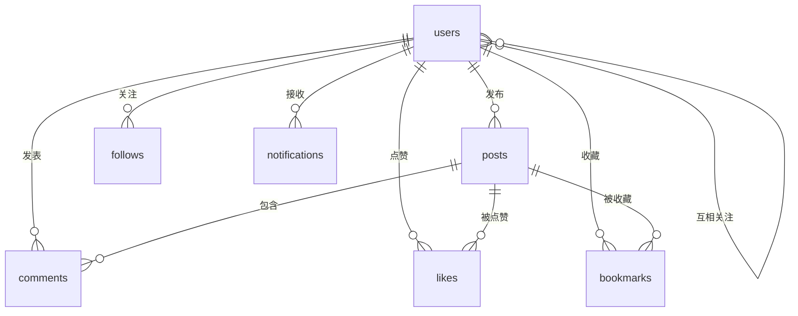
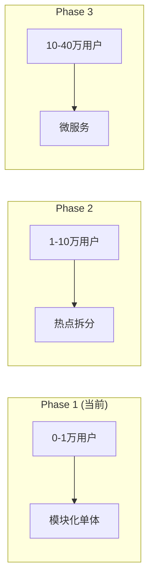

> 开源副本：部署地址已替换为示例；历史验证记录不代表当前部署状态。

# 失业么 (Shiyemo) - 项目架构概览

> 生成时间：2026-07-27
> 目的：帮助开发者快速建立对项目的全局心智模型，支持未来功能规划和架构演进

---

## 1. 项目定位

### 1.1 一句话定位

**失业么** —— AI 时代个体的"能力重建与收入重建"社区。

### 1.2 核心价值主张

面向失业/待转型技术人，通过「情绪共鸣 → 认知构建 → 行动发起 → 项目孵化」的完整路径，帮助个体找到新的收入方式和价值定位。

### 1.3 产品调性

**情绪疗愈型**：「慢慢来，没有人在催你」。目标用户处于焦虑/低能量状态，使用场景是长时间浏览、反复回访，而非快速完成任务。

### 1.4 北极星指标

| 指标 | 说明 |
|------|------|
| 项目发起数 | 有多少人开始行动 |
| 合作建立次数 | 陌生人协作的频率 |
| 实际完成项目数 | 从想法到落地的转化 |

---

## 2. 技术全景

### 2.1 技术栈总览

```
┌─────────────────────────────────────────────────────────────────────────┐
│                           技术栈全景                                     │
├─────────────────────────────────────────────────────────────────────────┤
│  前端          │ Next.js 16.2.6 + React 19.2.4 + TypeScript + Tailwind v4 │
│  后端          │ Go 1.24.0 (toolchain go1.24.11) + Gin + GORM             │
│  数据库        │ PostgreSQL 15                                             │
│  缓存          │ Redis 7                                                  │
│  搜索引擎      │ Meilisearch                                              │
│  对象存储      │ MinIO / 本地文件                                         │
│  实时通信      │ WebSocket (gorilla/websocket)                            │
│  移动端        │ Android (Kotlin + Compose)                                │
└─────────────────────────────────────────────────────────────────────────┘
```

### 2.2 核心依赖

| 依赖 | 版本 | 用途 |
|------|------|------|
| gin-gonic/gin | v1.9.1 | HTTP 框架 |
| gorm.io/gorm | v1.25.5 | ORM |
| jwt v5 | v5.3.1 | 认证 |
| redis/go-redis | v9.19.0 | 缓存 |
| meilisearch-go | v0.36.2 | 全文搜索 |
| minio-go | v7.0.0 | 对象存储 |
| stretchr/testify | v1.11.1 | 测试 |

---

## 3. 目录地图

### 3.1 整体结构

```
shiyemo/
├── server/                     # Go 后端
│   ├── cmd/main.go             # 路由注册总入口
│   ├── internal/               # 30 个业务模块
│   │   ├── auth/              # 认证 (handler/service/repo/model)
│   │   ├── user/              # 用户
│   │   ├── post/              # 帖子
│   │   ├── comment/           # 评论
│   │   ├── interaction/       # 点赞/收藏
│   │   ├── follow/            # 关注
│   │   ├── notification/      # 通知
│   │   ├── search/            # 搜索
│   │   ├── moderation/        # 内容审核
│   │   ├── admin/             # 管理后台
│   │   ├── journal/            # 静思空间 - 私密日记
│   │   ├── reading/           # 静思空间 - 今日阅读
│   │   ├── ambientsound/      # 静思空间 - 环境音
│   │   ├── checkin/           # 打卡
│   │   ├── cohort/            # 同温层
│   │   ├── stats/             # 统计
│   │   ├── feedback/          # 反馈
│   │   ├── tips/              # 生存小贴士
│   │   ├── dailyimage/        # 每日风景图
│   │   ├── setting/           # SMTP 配置
│   │   ├── verify/            # 邮箱验证
│   │   ├── upload/            # 文件上传
│   │   ├── export/            # 数据导出
│   │   ├── backup/            # 备份
│   │   ├── health/            # 健康检查
│   │   ├── websocket/         # WebSocket
│   │   ├── tag/               # 标签
│   │   ├── report/            # 举报
│   │   ├── log/               # 日志
│   │   └── common/            # 公共组件 (config, database, cache, email, middleware, errors, response, jwt, storage, anonymous)
│   ├── migrations/           # 手写 SQL 迁移 (001-024, 有重复)
│   └── tests/integration/     # L2 集成测试
│
├── web/                        # Next.js 前端
│   ├── src/
│   │   ├── app/               # 页面路由
│   │   │   ├── feed/          # 信息流
│   │   │   ├── posts/        # 帖子相关
│   │   │   ├── sanctuary/    # 静思空间
│   │   │   ├── profile/      # 个人主页
│   │   │   ├── admin/        # 管理后台
│   │   │   ├── checkin/      # 打卡
│   │   │   └── ...
│   │   ├── components/       # 组件库
│   │   │   ├── PostCard.tsx
│   │   │   ├── Navbar.tsx
│   │   │   ├── BreathingCircle.tsx
│   │   │   ├── AmbientPlayer.tsx
│   │   │   ├── ReadingCard.tsx
│   │   │   └── ...
│   │   ├── lib/               # 工具函数
│   │   │   ├── api.ts        # API 客户端
│   │   │   ├── constants.ts   # 常量定义
│   │   │   └── utils.ts
│   │   └── __tests__/         # 单元测试
│   └── scripts/
│       ├── check-design.mjs   # 视觉契约检查
│       └── design-baseline.json  # 遗留色基线
│
├── android/                    # Android App (独立)
├── docs/                       # 产品/架构/规范/流程文档
├── specs/                      # OpenSpec 提案
├── scripts/                    # 工具脚本
├── deploy/                     # Docker 部署配置
├── AGENTS.md                   # AI 开发规范 (必读)
├── WORKFLOW.md                 # 环境备注
└── HANDOFF.md                  # 项目交接文档
```

### 3.2 模块标准结构

```
internal/<module>/
├── handler.go          # HTTP 处理层 (参数校验、调用 service、返回响应)
├── service.go          # 业务逻辑层 (事务编排)
├── service_test.go     # 单元测试 (必须, 覆盖率 ≥80%)
├── repo.go             # 数据访问层 (CRUD)
├── repo_test.go        # 单元测试 (必须)
├── model.go            # 数据模型 (可选)
└── mock_test.go        # Mock 测试 (可选)
```

---

## 4. 架构分层

### 4.1 分层规范

```
┌─────────────────────────────────────────────────────────────────────┐
│                         分层架构                                      │
├─────────────────────────────────────────────────────────────────────┤
│  handler (HTTP)     │ 参数校验、调用 service、返回响应                 │
│       ↓              │                                                │
│  service (业务)      │ 业务逻辑、事务编排                              │
│       ↓              │                                                │
│  repo (数据)         │ 数据库 CRUD                                    │
│       ↓              │                                                │
│  PostgreSQL         │ 持久化存储                                      │
└─────────────────────────────────────────────────────────────────────┘
```

### 4.2 禁止事项 (红线)

| 禁止项 | 说明 |
|--------|------|
| handler 层写业务逻辑 | 只做参数校验和响应处理 |
| 直接拼接 SQL | 必须用 GORM |
| 修改已有迁移文件 | 新增迁移必须不撞号 |
| 引入 Java/Python | 不得改变后端技术栈 |
| 使用其他 ORM | 必须用 GORM |
| Phase1 拆分微服务 | 保持模块化单体 |

---

## 5. 核心业务流程

### 5.1 用户注册登录流程

```
用户输入邮箱/手机 → 发送验证码 → 验证成功 → 创建账户 → 生成 JWT → 登录完成
```

| 接口 | 说明 |
|------|------|
| POST /auth/register/email | 邮箱注册 |
| POST /auth/register/phone | 手机号注册 |
| POST /auth/login/email | 邮箱登录 |
| POST /auth/login/phone | 手机号登录 |
| GET /auth/verify/:token | 邮箱验证 |
| POST /auth/verify/send | 发送验证邮件 |

### 5.2 帖子发布流程

```
用户发帖 → 邮箱验证检查 → 创建帖子 → 内容审核 → 发布成功 → 通知粉丝
```

| 接口 | 说明 |
|------|------|
| POST /posts | 创建帖子 (需要邮箱验证) |
| PUT /posts/:id | 编辑帖子 |
| DELETE /posts/:id | 删除帖子 |
| GET /posts/:id | 帖子详情 |

### 5.3 静思空间流程 (Phase1 新增)

```
进入静思空间 → 呼吸练习 → 环境音 → 今日阅读 → 私密日记
```

| 模块 | 功能 |
|------|------|
| journal | 私密日记 (增删查) |
| reading | 今日阅读 (随机/当日) |
| ambientsound | 环境音 (CC0 外链) |

### 5.4 信息流分发

```
关注 Feed    → 关注用户的帖子
同温层 Feed  → 同城市/同行业的帖子
热门 Feed    → 按点赞+评论排序
```

---

## 6. 数据模型

### 6.1 核心实体关系



### 6.2 核心表结构

#### users (用户表)

| 字段 | 类型 | 说明 |
|------|------|------|
| id | BIGSERIAL | 主键 |
| phone | VARCHAR(20) | 手机号 (唯一) |
| email | VARCHAR(255) | 邮箱 (唯一) |
| password | VARCHAR(255) | 密码哈希 |
| nickname | VARCHAR(50) | 昵称 |
| company | VARCHAR(100) | 前公司 |
| occupation | VARCHAR(100) | 职业 |
| avatar | VARCHAR(500) | 头像 URL |
| status | SMALLINT | 状态 (1-正常, 0-禁用) |

#### posts (帖子表)

| 字段 | 类型 | 说明 |
|------|------|------|
| id | BIGSERIAL | 主键 |
| user_id | BIGINT | 发布者 ID |
| type | VARCHAR(20) | 类型: emotion/insight/case/action/achievement |
| title | VARCHAR(200) | 标题 |
| content | TEXT | 内容 |
| images | JSONB | 图片数组 |
| tags | JSONB | 标签数组 |
| like_count | INT | 点赞数 |
| comment_count | INT | 评论数 |
| is_top | BOOL | 是否置顶 |
| is_featured | BOOL | 是否加精 |
| is_anonymous | BOOL | 是否匿名 |
| status | INT | 状态 (0-草稿, 1-已发布, 2-隐藏, 3-删除) |
| review_status | VARCHAR(20) | 审核状态 (pending/approved/rejected) |

#### journals (日记表) - 静思空间

| 字段 | 类型 | 说明 |
|------|------|------|
| id | BIGSERIAL | 主键 |
| user_id | BIGINT | 用户 ID |
| content | TEXT | 日记内容 |
| mood | VARCHAR(20) | 当日心情 |
| created_at | TIMESTAMP | 创建时间 |

#### readings (今日阅读表)

| 字段 | 类型 | 说明 |
|------|------|------|
| id | BIGSERIAL | 主键 |
| content | TEXT | 阅读内容 |
| source | VARCHAR(200) | 来源 |
| author | VARCHAR(100) | 作者 |
| is_active | BOOL | 是否启用 |

#### ambient_sounds (环境音表)

| 字段 | 类型 | 说明 |
|------|------|------|
| id | BIGSERIAL | 主键 |
| name | VARCHAR(100) | 名称 |
| url | VARCHAR(500) | 音频 URL (外链) |
| category | VARCHAR(50) | 分类 |
| duration | INT | 时长 (秒) |
| sort_order | INT | 排序 |

### 6.3 帖子类型 (内容模型)

| 类型 | 色相 | 说明 | 示例 |
|------|------|------|------|
| emotion | 灰玫瑰 (15°) | 情绪共鸣 | "失业第30天，我开始焦虑了" |
| insight | 赭黄 (80°) | 认知分享 | "被裁后我学到的3件事" |
| case | 雾蓝 (235°) | 案例复盘 | "从0到1做自由职业的经历" |
| action | 鼠尾草绿 (155°) | 行动发起 | "一起做个副业项目？" |
| achievement | 暖梅 (330°) | 成果展示 | "AI 帮我接了第一单" |

---

## 7. API 设计

### 7.1 统一响应格式

```json
{
  "code": 0,
  "message": "ok",
  "data": {}
}
```

### 7.2 错误码规范

| 类别 | 范围 | 示例 |
|------|------|------|
| 参数错误 | 400xx | 40001 参数错误 |
| 认证错误 | 401xx | 40101 未登录 |
| 用户错误 | 402xx | 40201 手机号已注册 |
| 帖子错误 | 403xx | 40301 帖子不存在 |
| 服务错误 | 500xx | 50001 数据库错误 |

### 7.3 API 分组

| 分组 | 前缀 | 认证 | 说明 |
|------|------|------|------|
| 公开接口 | /api/v1 | 否 | 注册、登录、帖子列表 |
| 认证接口 | /api/v1 | JWT | 发帖、点赞、收藏 |
| 管理员接口 | /api/v1/admin | JWT + Admin | 删除帖子、用户管理 |

---

## 8. 前端设计系统

### 8.1 设计原则

**暖调低饱和**：不刺激、不催促、长时间阅读不疲劳。面向焦虑/低能量用户。

### 8.2 语义化颜色令牌

```css
/* 画布与表面 */
--color-canvas       /* 暖白背景 */
--color-surface      /* 卡片表面 */
--color-surface-sunk /* 下沉表面 */

/* 文字 */
--color-ink          /* 主要文字 */
--color-ink-soft     /* 次要文字 */
--color-ink-faint    /* 弱化文字 */

/* 主色 */
--color-accent       /* 鼠尾草绿 (主按钮/链接) */

/* 帖子类型色 */
--color-emotion-*    /* 灰玫瑰 */
--color-insight-*    /* 赭黄 */
--color-case-*       /* 雾蓝 */
--color-action-*     /* 鼠尾草绿 */
--color-achievement-* /* 暖梅 */
```

### 8.3 组件类

| 类名 | 用途 |
|------|------|
| `.card` | 卡片容器 |
| `.btn-primary` | 主按钮 |
| `.btn-secondary` | 次按钮 |
| `.input-field` | 输入框 |
| `.gradient-text` | 渐变文字 |

---

## 9. 演进路线



### Phase1 (当前)

| 维度 | 说明 |
|------|------|
| 架构 | 模块化单体 |
| 目标用户 | 0-1 万 |
| 基础设施 | PostgreSQL, Redis, Meilisearch |
| 护栏 | L1 单测, L2 集成测试, L3 BDD 验证 |

### Phase2 (规划)

| 维度 | 说明 |
|------|------|
| 架构 | 热点拆分 |
| 目标用户 | 1-10 万 |
| 新增 | Elasticsearch, 消息队列 |
| 拆分方向 | 搜索服务, 通知服务 |

### Phase3 (展望)

| 维度 | 说明 |
|------|------|
| 架构 | 微服务 |
| 目标用户 | 10-40 万 |
| 基础设施 | K8s, 服务发现, 链路追踪 |
| 演进条件 | 用户量持续增长 |

---

## 10. 关键入口索引

| 主题 | 入口文件 | 说明 |
|------|----------|------|
| 后端路由 | `server/cmd/main.go` | 所有 API 路由注册 |
| 前端页面 | `web/src/app/` | 页面组件 |
| 用户认证 | `server/internal/auth/` | 登录/注册/JWT |
| 帖子系统 | `server/internal/post/` | 发帖/编辑/列表 |
| 静思空间 | `server/internal/journal/`, `reading/`, `ambientsound/` | 新增功能 |
| 设计系统 | `web/src/app/globals.css` | 颜色令牌 |
| API 契约 | `docs/API.md` | 接口文档 |
| 开发规范 | `AGENTS.md` | AI 开发红线 |
| 产品愿景 | `docs/00-产品/00-vision.md` | 产品定位 |
| OpenSpec | `specs/<feature>/design.md` | 功能规格 |

---

## 11. 当前进度与待办

### 11.1 已完成功能

| 功能 | 状态 | 说明 |
|------|------|------|
| 用户认证 | ✅ | 邮箱/手机号注册登录, JWT |
| 帖子系统 | ✅ | 5 种类型, 评论, 点赞, 收藏 |
| 信息流 | ✅ | 关注/同温层/热门 Feed |
| 搜索 | ✅ | Meilisearch 全文搜索 |
| 静思空间 | ✅ | 呼吸练习, 环境音, 今日阅读, 私密日记 |
| 打卡 | ✅ | 自由日打卡 |
| 同温层 | ✅ | 按城市/行业分组 |
| 管理后台 | ✅ | 内容审核, 用户管理 |
| 视觉重做 | ✅ | 暖调低饱和设计 |
| 后端单测 | ✅ | 33 模块全过 |

### 11.2 P0 待办

| 任务 | 优先级 | 说明 |
|------|--------|------|
| 部署脚本地址修复 | P0 | `app.example.com` → `app.example.com` |
| 干净环境验证 | P0 | 新迁移 (020/021/024) 未在生产真跑 |
| 凭据轮换 | P0 | `.env` 可能泄露在 git 历史 |
| 服务器共存约束 | P0 | 不能抢 :80 |

### 11.3 未来规划方向

| 方向 | 说明 |
|------|------|
| action 扩展 | Phase1 不实现，Phase2 规划 |
| 项目孵化 | action → 团队组建 → 项目管理 |
| 需求方接入 | 画像 C：中小企业主 |
| 推荐算法 | MVP 阶段禁止，Phase2+ |

---

*文档版本：1.0*
*最后更新：2026-07-27*
