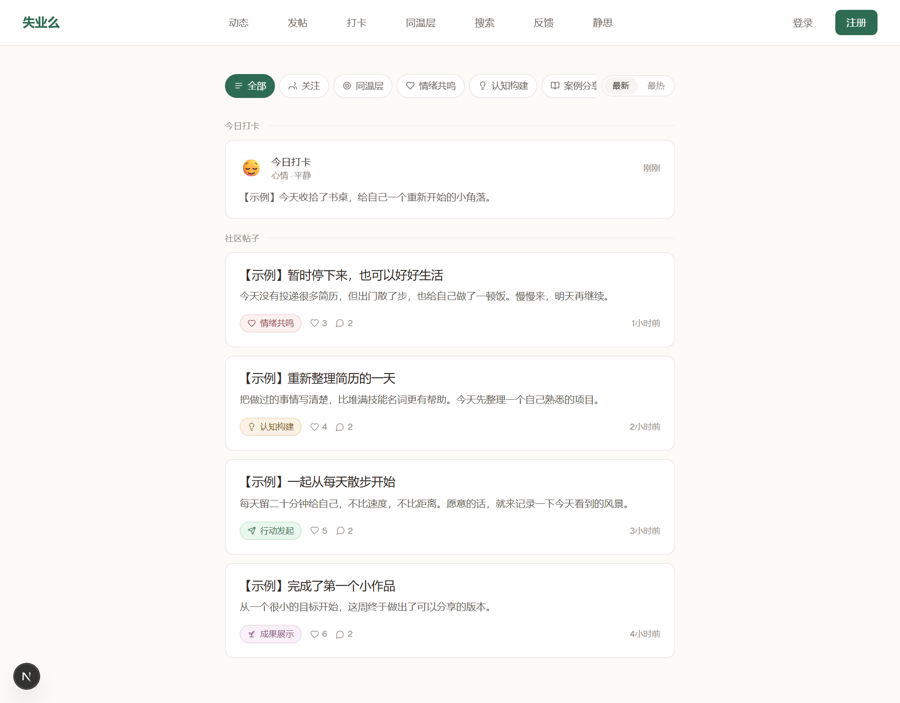
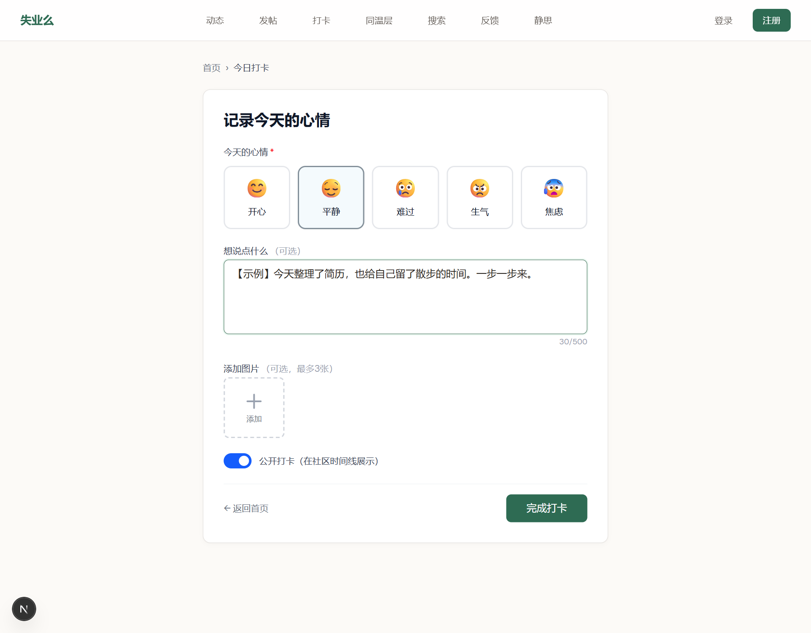
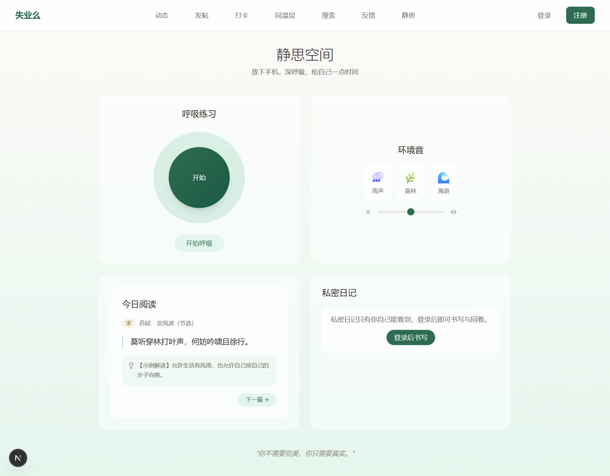
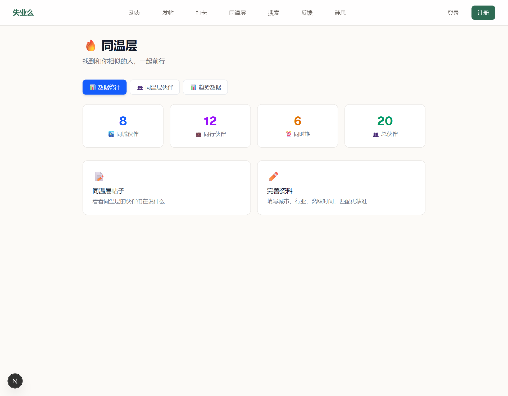
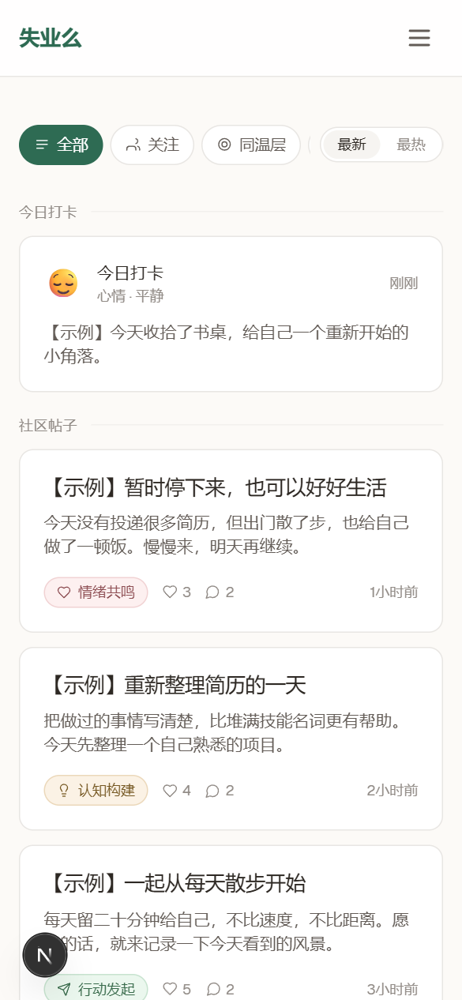

# 功能与界面导览

[返回项目首页](../README.md)

失业么面向失业、待转型和重新出发的人。你可以先浏览近况，留下自己的记录，或者到静思空间休息一会儿；不需要一进来就发布一篇完整的经验总结。

> 本文截图来自当前开源 Web 前端，以虚构接口数据演示。帖子、统计与解读均为示例，不含真实用户资料。截图验证了页面展示，未验证真实登录、提交保存、音频播放或线上服务；手机图是浏览器窄屏预览，不是真机验收。左下角的 Next.js 标记来自本地开发预览。

## 1. 社区动态：浏览、筛选，再参与讨论

入口：顶部「动态」，页面路径 `/feed`。

页面将「今日打卡」与「社区帖子」分开。帖子卡片展示标题、摘要、类别、点赞数、评论数和时间；顶部分类栏可以横向滚动，切换内容类型，右侧支持最新 / 最热排序。

五类内容分别容纳不同表达：

| 类型 | 适合发布什么 |
| --- | --- |
| 情绪共鸣 | 今天的感受、困惑，或者想说给别人听的一件小事 |
| 认知构建 | 学到的新方法、对工作的重新理解、整理后的思路 |
| 案例分享 | 一次面试、转型尝试或项目经历中的具体过程 |
| 行动发起 | 发起读书、练习、散步等可以一起参与的小行动 |
| 成果展示 | 完成的作品、阶段进展和行动后的复盘 |

发布流程：进入「发帖」→ 选择类型 → 填写标题与富文本正文 → 按需添加标签和匿名选项 → 发布。发布及互动需要有效登录，邮箱验证要求由后端执行。匿名是发帖展示选项，不等于平台不保留作者信息。

## 2. 每日打卡：用很小的成本留下记录

入口：顶部「打卡」，页面路径 `/checkin`。

从开心、平静、难过、生气、焦虑中选择一种心情；文字可不填，最多 500 字，图片最多三张。公开开关决定是否在社区时间线展示。提交成功后页面会展示当天的打卡结果。

例如：今天只完成了整理书桌，也可以写下来。图片展示的是未提交的表单；实际保存需要登录及可用的后端和上传配置。页面虽有「查看历史」入口，当前 Web 快照中未找到 `/checkin/history` 页面，因此这里不将历史页列为已交付功能。

## 3. 静思空间：从交流切换到独处

入口：顶部「静思」，页面路径 `/sanctuary`。

| 模块 | 界面交互 |
| --- | --- |
| 呼吸练习 | 点击开始，跟随圆形动画进行呼吸练习 |
| 环境音 | 选择音效、调节音量，再次点击暂停；具体列表由后端维护 |
| 今日阅读 | 查看短篇文字与解读，点击「下一篇」切换 |
| 私密日记 | 登录后书写、回看与删除自己的日记；未登录显示登录入口 |

这个页面可以直接浏览，日记单独要求登录。示例中的雨声、森林、海浪展示了环境音按钮的布局；截图未加载或播放真实音频。部署时需提供可访问且符合授权要求的音频资源。

## 4. 同温层：看看处境相近的人

入口：顶部「同温层」，页面路径 `/cohort`。

页面提供「数据统计」「同温层伙伴」「趋势数据」三个标签。统计页展示同城、同行、同一离职时期和总伙伴数量；伙伴页展示昵称、简介及相关资料，并可继续查看个人页面。

可以先在个人资料中填写城市、行业、离职时间，再进入同温层浏览。这里按已有资料进行匹配，不将其描述为 AI 推荐；图中的数字只用于说明布局，未验证匹配和趋势接口的实际结果。

## 5. 手机浏览：把长列表变成随手可读的卡片

手机宽度下导航折叠为菜单，动态采用单列卡片，类型筛选可以横向滚动。上图展示 Web 页面，而非 Android 原生客户端。仓库另有 Android 源码，两端的功能范围和完成状态需要分别核验。

## 6. 其他入口与管理能力

| 入口 | 路径 | 用途 |
| --- | --- | --- |
| 首页 | `/` | 每日场景与文案、社区介绍和进入动态的入口 |
| 发布帖子 | `/posts/create` | 分类、标题、富文本、标签和匿名选项 |
| 搜索 | `/search` | 查找社区内容 |
| 收藏 | `/bookmarks` | 回看收藏的内容 |
| 个人资料 | `/profile` | 维护昵称、头像及同温层所需资料 |
| 通知 | `/notifications` | 查看账户相关通知 |
| 反馈 | `/feedback` | 提交问题与建议 |
| 管理后台 | `/admin` | 管理员查看概况、审核内容及处理举报和反馈 |

管理端包含审核、评论、举报、反馈、图片和设置等页面，只供具备相应权限的账号使用。本次导览没有拍摄管理员或真实账号数据，也不意味着上述流程都经过了端到端验证。

## 从哪里开始体验

1. 按 [README 的运行说明](../README.md#运行docker-compose) 启动自己的环境并配置服务。
2. 先浏览动态与静思空间，了解页面结构。
3. 注册并按环境要求完成邮箱验证，试着发一条帖子或保存一次打卡。
4. 完善资料，再体验同温层、关注与收藏。

这些截图的示例内容不会自动写入你的数据库。部署配置与依赖说明见 [项目 README](../README.md)，此文仅作为产品和界面导览。
